<p align="center">
  <a href="https://www.skool.com/mokkapp-1438/about">
    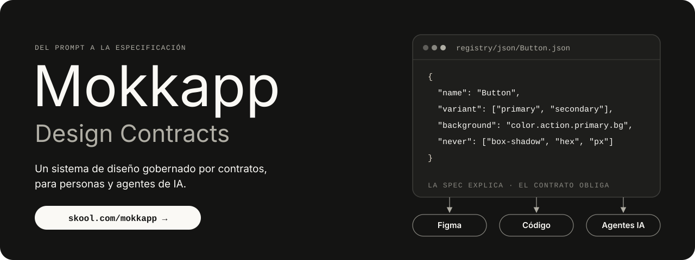
  </a>
</p>

<p align="center">
  <a href="https://www.skool.com/mokkapp-1438/about">
    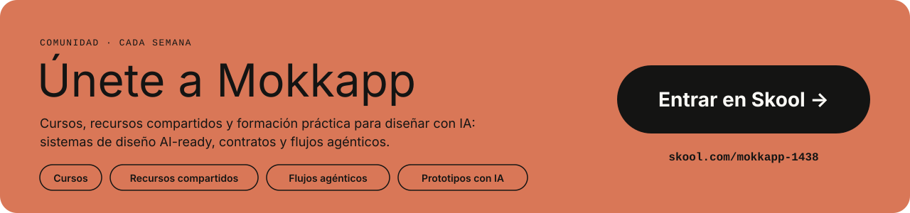
  </a>
</p>

<p align="center">
  <a href="https://www.skool.com/mokkapp-1438/about"></a>
</p>

<p align="center">
  
  
  
  
  
</p>

<p align="center">
  
  
  
  
  
  
</p>

<br>

> **Un prompt es una conversación. Una especificación es un acuerdo.**
>
> *Design Contracts* es un sistema de diseño pequeño en el que personas y agentes de IA trabajan desde la misma fuente de verdad: **tokens, contratos y tests**. La IA no inventa colores, medidas ni variantes, porque todo lo que puede usar está escrito y se comprueba.

<br>

## El esquema

<p align="center">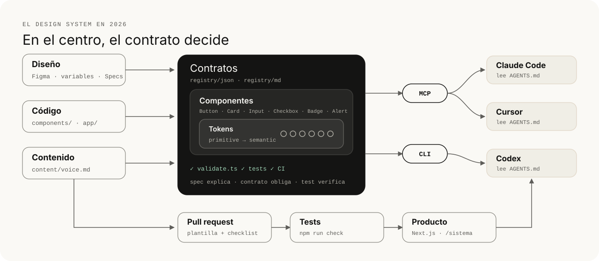</p>

| Pieza | Dónde vive |
|:--|:--|
| **Diseño** | Figma, conectado por MCP · [`figma/`](figma/README.md) |
| **Código** | [`components/`](components) y [`app/`](app) (Next.js) |
| **Contenido** | [`content/voice.md`](content/voice.md) · [`content/brand.md`](content/brand.md) |
| **Contratos** | [`registry/`](registry) |
| **Tokens** | [`tokens/primitive/`](tokens/primitive) · [`tokens/semantic/`](tokens/semantic) |
| **MCP** | [`.mcp.json`](.mcp.json) (Claude Code) · [`.cursor/mcp.json`](.cursor/mcp.json) (Cursor) |
| **Agentes** | [`AGENTS.md`](AGENTS.md) · [`CLAUDE.md`](CLAUDE.md) · [`.claude/skills/`](.claude/skills) |
| **PR y tests** | [`.github/`](.github) · `npm run check` |

<br>

## Empezar

<p align="center">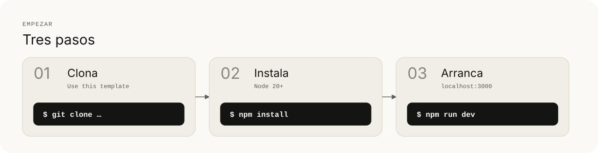</p>

```bash
npm install
npm run dev        # genera los tokens y abre http://localhost:3000
```

| Ruta | Qué ves |
|:--|:--|
| `localhost:3000` | **Sandbox:** prueba cada componente cambiando variantes y textos, y repasa colores, tipografía, radios y espaciado |
| `localhost:3000/sistema` | Documentación viva, generada desde tokens y contratos |

<p align="center">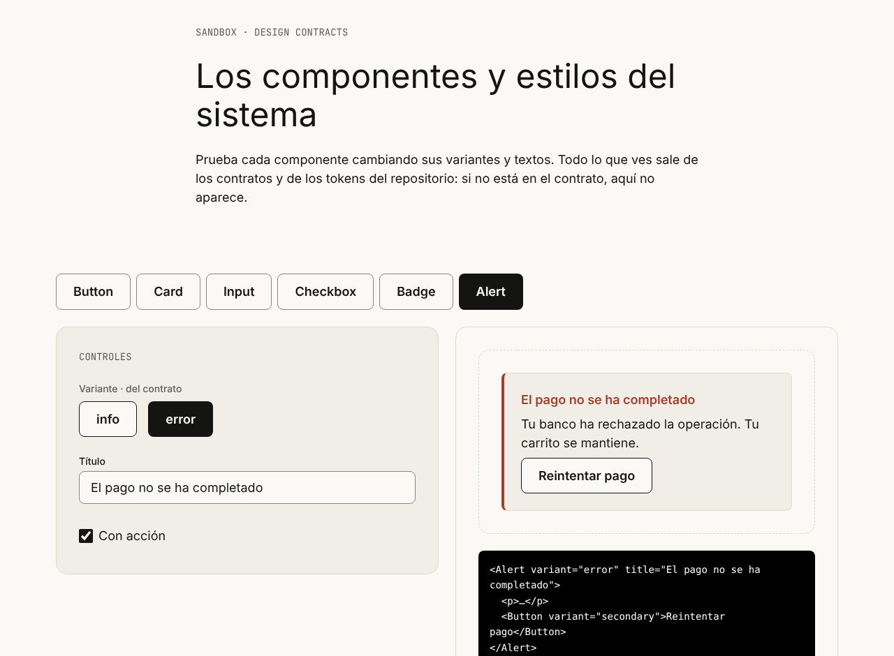</p>

<br>

## Cómo funciona

<p align="center">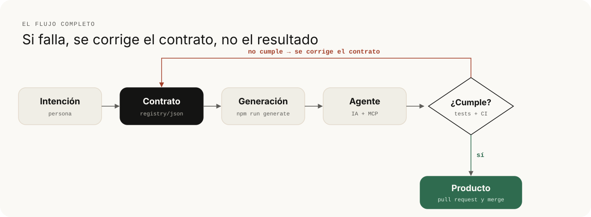</p>

1. Una persona escribe la **intención** como **contrato**.
2. Un script **genera** lo mecánico: variables CSS y spec legible.
3. El **agente** construye leyendo el contrato, no adivinando.
4. Los tests y la CI **verifican**. Si algo no cumple, no entra.
5. Si falla, **se corrige el contrato**: así se arregla esta vez y todas las siguientes.

<br>

## El repositorio, de un vistazo

<p align="center">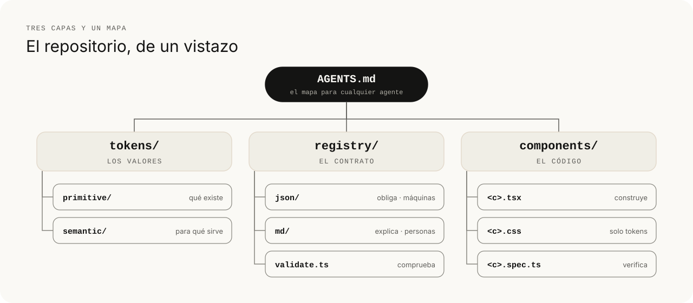</p>

<br>

## Tokens en dos capas

<p align="center">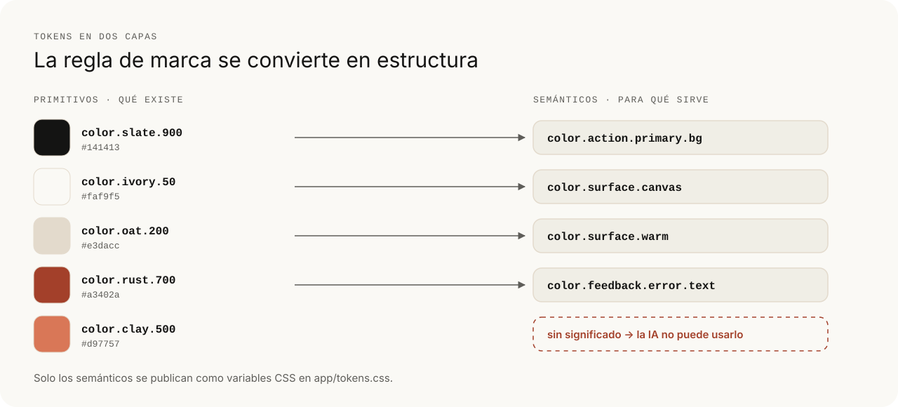</p>

**Primitivos** = qué existe. **Semánticos** = para qué sirve. Solo los semánticos llegan al CSS, así que un color sin significado, como `clay`, existe en la paleta pero **la interfaz no puede usarlo**.

<br>

## Un componente = 5 archivos

<p align="center">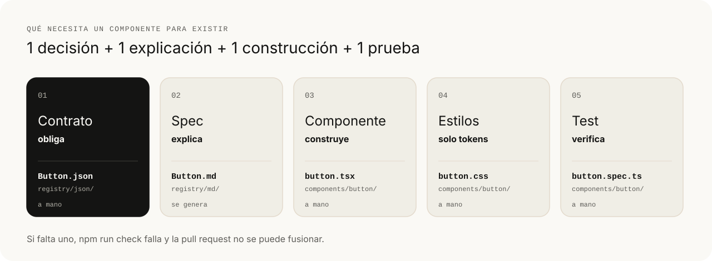</p>

<table>
<tr><td>

**Contrato** · `registry/json/<C>.json`<br>
<sub>obliga · lo leen máquinas y agentes</sub>

</td><td>

**Spec** · `registry/md/<C>.md`<br>
<sub>explica · se genera desde el contrato</sub>

</td><td>

**Test** · `components/<c>/<c>.spec.ts`<br>
<sub>verifica · se ejecuta en cada PR</sub>

</td></tr>
</table>

### Componentes incluidos

| Componente | Variantes y estados | Para qué |
|:--|:--|:--|
| `Button` | primary · secondary · tertiary · disabled | Acciones |
| `Card` | cream · warm | Agrupar contenido |
| `Input` | default · hover · focus · error · disabled | Campos con etiqueta, ayuda y error |
| `Checkbox` | sin marcar · marcado · error · disabled | Opciones independientes |
| `Badge` | neutral · strong · outline | Clasificar o indicar estado |
| `Alert` | info · error | Resultado de una acción importante |

<p align="center">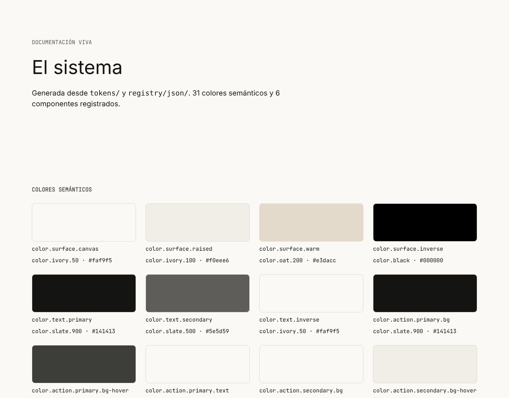</p>

<br>

## El validador

<p align="center">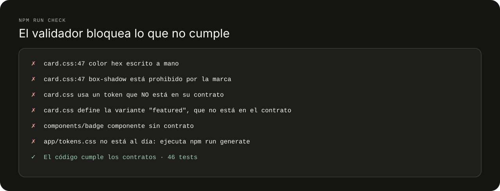</p>

| Comando | Qué hace |
|:--|:--|
| `npm run generate` | tokens → `app/tokens.css` + `docs/DESIGN.md` · contratos → `registry/md/` |
| `npm run validate` | Comprueba que el código cumple los contratos |
| `npm test` | Ejecuta las specs de cada componente |
| `npm run check` | Todo lo anterior. Es lo que ejecuta la CI en cada pull request |

> Pruébalo: añade `box-shadow: 0 4px 12px #0003;` a `components/card/card.css` y ejecuta `npm run check`.

<br>

## Agentes de IA y la skill `figma-contract`

<p align="center">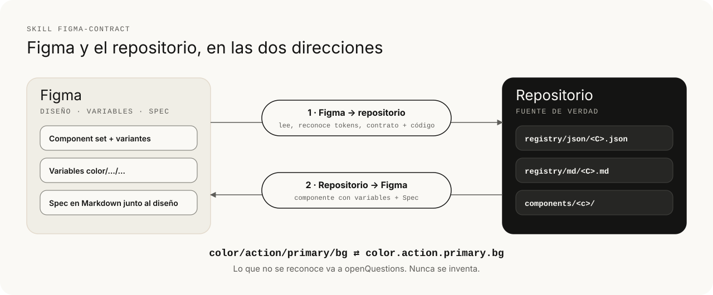</p>

Abre el repositorio en **Claude Code**, **Cursor** o **Codex**. El agente lee [`AGENTS.md`](AGENTS.md) y, para Figma, la skill [`.claude/skills/figma-contract`](.claude/skills/figma-contract/SKILL.md).

| Quiero… | Pídeselo así |
|:--|:--|
| **Figma → código** | *Crea el contrato de este componente de Figma y pásalo a código: [enlace]* |
| **Spec de Figma → contrato** | *Crea el contrato a partir de esta Spec de Figma: [enlace]* |
| **Contrato → Figma** | *Genera en Figma el componente Badge en este archivo: [enlace]* |
| **Una página** | *Crea una página `/contacto` con nombre, correo con error si no es válido, una casilla de condiciones y un botón para enviar.* |
| **Probar el contrato** | *Añade una sombra a las tarjetas para que destaquen más.* |

El último encargo debería fallar: el contrato lo prohíbe y `npm run check` lo detecta.

<br>

## Gobernanza

| | |
|:--|:--|
| **Una fuente de verdad** | Se editan `tokens/` y `registry/json/`; el resto se genera |
| **El contrato primero** | Ningún componente ni variante sin su contrato |
| **Pull requests** | Plantilla con checklist y CI en verde |
| **Versiones** | `x.y.z` en cada contrato y entrada en [`CHANGELOG.md`](CHANGELOG.md) |
| **Responsables** | [`CODEOWNERS`](.github/CODEOWNERS) aprueba tokens, contratos y contenido |
| **Decisiones por escrito** | Cada contrato guarda `decisions` (con su porqué) y `openQuestions` |

<br>

<p align="center">
  <a href="https://www.skool.com/mokkapp-1438/about">
    
  </a>
</p>

<p align="center">
  <b>Xavier Pascual · <a href="https://mokkapp.com">Mokkapp.com</a></b><br>
  <sub>Identidad visual de ejemplo: sistema editorial monocromo · Tipografías libres: Inter y JetBrains Mono · Licencia MIT</sub>
</p>
